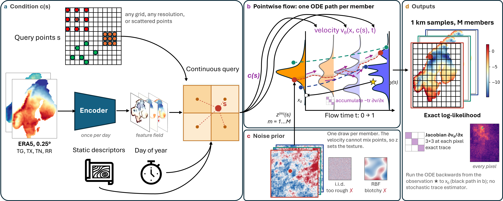
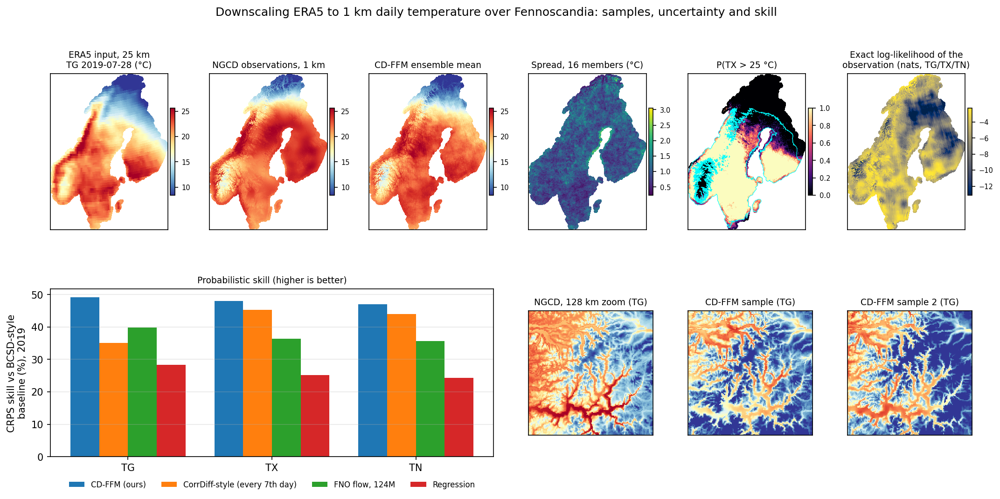

# CD-FFM: climate downscaling with likelihood functional flow matching

Code for *Climate downscaling with likelihood functional flow matching* (Liu, Toropainen and Boy; under review).

CD-FFM downscales ERA5 reanalysis (0.25°, about 25 km) to 1 km daily temperature over Norway, Sweden and Finland
(the Nordic Gridded Climate Dataset, NGCD). It treats the high-resolution field as a **random function of
location**: the coarse input is encoded once, any set of coordinates is queried through a continuous implicit
representation, and a small velocity network transports a Gaussian random field to the target, independently at
every location.


Because the velocity acts pointwise:

- **Resolution-free.** One sample can be queried on any grid or on scattered points; shared points keep exactly
  the same value (to 1e-5 °C) whatever else is queried.
- **The noise prior is the texture model.** The network cannot move information between locations, so the
  spatial structure of a sample comes from the noise. We draw it from a power-law spectrum matched to the
  observations (β = 2.4, wavelengths 8–500 km).
- **Exact likelihood.** At each location the flow is a 3-dimensional ODE, so the likelihood of every observed
  pixel follows exactly from the change-of-variables formula (3×3 Jacobian trace, no stochastic estimator).
- **Cheap.** 3.2 M parameters, about one GPU-hour of training; a distilled flow map draws a 1 km field of the
  whole domain (1.33 M points) in about 0.35 s per ensemble member.



## Results (test year 2019, every day, all 1.33 M land pixels)

| Model | Parameters | CRPS TG / TX / TN (°C) | Log score (nats) |
|---|---|---|---|
| **CD-FFM**, flow map, 2 steps, 16 members | 3.2 M | **1.008 / 0.522 / 0.689** | — |
| CD-FFM, 10 Euler steps | 3.2 M | 1.034 / 0.530 / 0.699 | **4.71** |
| FNO-encoder flow, same setup | 124 M | 1.195 / 0.639 / 0.837 | 9.12 |
| Regression, same network and inputs | 3.2 M | 1.422 / 0.752 / 0.986 | 5.10 |
| BCSD-style statistical baseline | — | 1.984 / 1.005 / 1.302 | — |

On the 55 days on which we could afford to sample it (every 7th day, 8 members), a CorrDiff-style two-stage
diffusion model scores 1.288 / 0.549 / 0.730 against 1.064 / 0.523 / 0.694 for the CD-FFM flow map, while needing
about 50× more time per sample. Gains over regression hold in each of the test years 2016, 2018 and 2019 (block-bootstrap
intervals in the paper).



## Repository layout

```
run.py              runs a command list from configs/commands/ on this computer (line by line, logs in logs/)
scripts/            all code (run from this directory; modules import each other by name)
  paths.py            CDFFM_ROOT: where data, runs and figures live (default ./work)
  download_ngcd.py, subset_aggregate_era5.py, compute_norm_stats.py, preprocess_fast.py, climstats.py,
  ngcd_io.py, transforms.py                        data download and preprocessing
  fast_data.py        data on GPU / RAM / disk, noise priors (RBF / power law), precipitation transform, ODE sampler
  model.py, flower_layers.py, fno_layers.py, fno_unet.py   encoder, continuous query, velocity / flow-map nets
  fast_train.py       training (flow matching, regression, flow-map distillation)
  fast_eval.py        evaluation: fair CRPS, spread/skill, Brier, rank histograms, spectra, map fields
  fast_logscore.py    exact log score (backward RK4 ODE with exact Jacobian trace)
  diffusion_baseline.py   CorrDiff-style baseline (UNet regression + EDM residual diffusion, tiled inference)
  influence_maps.py, paper_figdata.py, precip_tricks.py    analyses for the figures
  paper_figs.py, paper_summary_figs.py, compare_eval.py, influence_figs.py, diagnose_speckle.py,
  precip_tricks_fig.py, make_tables.py, bootstrap_ci.py, check_tg_consistency.py, test_noise_kernel.py
configs/train/      the arguments of every trained model in the paper, as recorded at training time
configs/commands/   the exact command lines behind every table and figure, in pipeline order (01 ... 11)
pretrained/         weights-only checkpoints of the released models (see below)
figures/            key figures of the paper
slurm/              optional: the same command lists as Slurm job arrays, for clusters
```

## Installation

Everything runs with plain `python` on one computer; no cluster or job scheduler is needed.

```bash
git clone <this repository> CD-FFM && cd CD-FFM
python -m venv .venv && source .venv/bin/activate
pip install torch                       # first, the build for your hardware (CUDA, ROCm or CPU): pytorch.org
pip install -r requirements.txt
export CDFFM_ROOT=/large/disk/cdffm     # data, runs, figures (see Data); default ./work
```

**Hardware.** Every script uses the first GPU if there is one and the CPU otherwise; choose explicitly with
`--device cuda:1` or `--device cpu`. Evaluating the pretrained models works on a CPU (slowly: one 1 km field of the
Nordic domain is 1.33 million points), training needs a GPU. By default all training targets are kept on the GPU
(about 44 GB for 15 years, 3 GB per year), which is fastest; when they do not fit, `fast_train.py` keeps them in
host memory or reads them from the memory-mapped files on disk and moves only each batch to the GPU
(`--data-store auto|device|cpu|disk`; the batches are identical, only the speed differs). The paper's experiments
ran on single AMD Instinct MI250X dies (64 GB).

## Data

- **NGCD** (target): `insitu-gridded-observations-nordic` from the Copernicus Climate Data Store, daily TG, TX, TN
  and precipitation on a 1 km grid. `scripts/download_ngcd.py` downloads one year per call; it needs a CDS account
  (key in `~/.cdsapirc` or `CDSAPI_KEY`) and a one-time acceptance of the dataset licence on its web page.
  1981–2019 are used (climatologies 1981–2015, training 2001–2015, validation 2017, test 2016, 2018, 2019);
  the raw archive is about 1 TB.
- **ERA5** (input): 0.25° 2 m temperature and 6-hourly total precipitation, one netCDF file per year in
  `$CDFFM_ERA5_SOURCE/t2m/` and `$CDFFM_ERA5_SOURCE/tp6h/`. `scripts/subset_aggregate_era5.py` crops it to the
  Nordic domain and aggregates to daily mean / max / min temperature and daily precipitation. Note that the
  daily maximum and minimum are taken over the four 6-hourly values.
- After preprocessing, `$CDFFM_ROOT/fast_data/` holds 16-bit arrays ready for training (about 70 GB for all years).

## Reproducing the paper

Every step is a plain list of `python` command lines in `configs/commands/`. `run.py` runs a list in order on this
computer (in `scripts/`, with the current Python, output also saved in `logs/`):

```bash
python run.py configs/commands/01-04_data.txt          # download, crop ERA5, climatologies, preprocessing
python run.py configs/commands/05_train.txt --list     # show the numbered lines
python run.py configs/commands/05_train.txt --grep w2e_static_pl24_l8   # train only the final model
python run.py configs/commands/08_eval.txt --lines 0-7 # Table 1
```

Any single line can also be copied and run by hand from `scripts/`, e.g.
`cd scripts && python -u fast_eval.py --run w5_flowmap --ckpt best --members 16 --ode-steps 2 --year 2019 --tag final_map2`.

| Step | Command list | Needs | Time on one MI250X die |
|---|---|---|---|
| 1–4. Download, crop ERA5, climatologies, preprocessing | `01-04_data.txt` (in order) | CPU, network | download-bound |
| 5. Train the flow and regression models | `05_train.txt` | GPU | ≤ 4 h each (final model ~1 h) |
| 6. Distil the flow map (after `w2e_static_pl24_l8`) | `06_train_flowmap.txt` | GPU | 30 min |
| 7. CorrDiff-style baseline: UNet, then diffusion | `07a_train_corrdiff_reg.txt`, `07b_train_corrdiff_edm.txt` | GPU | 3 h + 10 h |
| 8. Evaluations (all tables) | `08_eval.txt` | GPU | minutes to ~1 h each |
| 9. Exact log scores | `09_logscore.txt` | GPU | minutes each |
| 10. Figure data, influence maps, precipitation study | `10_analysis_gpu.txt` | GPU | minutes to ~1 h each |
| 11. All figures and tables | `11_figures_tables.txt` | CPU | minutes |

All experiments in the paper, including discarded configurations, used about 110 GPU-hours.
Models are referred to by their run names (e.g. `w2e_static_pl24_l8`); `configs/train/<run>.json` states the
role of each (`_role`). The main ones:

| Run | Role |
|---|---|
| `w2e_static_pl24_l8` | CD-FFM, final model |
| `w5_flowmap` | distilled flow map of the final model |
| `w3_reg_static` | regression baseline (same network and inputs) |
| `w3_fno_final`, `w3_fno16_final` | FNO-encoder flows (124 M, 7.7 M parameters) |
| `w3_iid_static`, `w2d_static_rbf`, `w2d_static_pl24`, `w2e_static_pl24_l20` | noise-prior ablation |
| `w2b_pl24` | without static descriptors |
| `w1_flower_doy`, `w2_flower_y10`, `w2_flower_y15` | 5 / 10 / 15 training years |
| `w3_final_lapland` | northern region never sampled in training |
| `w4_rr_final`, `w4_rr_reg` | precipitation (additional experiment) |
| `w6_unet_reg`, `w6_corrdiff` | CorrDiff-style baseline |

## Pretrained models

`pretrained/runs/` contains the weights (exponential moving average, as used for evaluation) of the checkpoint
with the best validation score for

| Run | Model | Validation step |
|---|---|---|
| `w2e_static_pl24_l8` | CD-FFM, temperature (TG, TX, TN) | 40 000 |
| `w5_flowmap` | its distilled flow map (1–2 network evaluations per sample) | 12 000 |
| `w4_rr_final` | CD-FFM, precipitation | 20 000 |

Copy them into your runs directory and evaluate as usual; `--ckpt best` selects the released checkpoint:

```bash
mkdir -p $CDFFM_ROOT/runs && cp -r pretrained/runs/* $CDFFM_ROOT/runs/
cd scripts
python -u fast_eval.py --run w5_flowmap --ckpt best --members 16 --ode-steps 2 --year 2019 --tag test
python -u fast_eval.py --run w5_flowmap --ckpt best --members 2 --ode-steps 2 --day-stride 30 --tag cpu_test --device cpu
```

The models need the preprocessed inputs of the evaluated year plus `norm_stats.npz` and `fast_data/static.npz`
(climatologies and static descriptors). All of these, the weights of every model in the paper, and the evaluation
outputs behind every table and figure are in the data record on Zenodo ([10.5281/zenodo.23496724](https://doi.org/10.5281/zenodo.23496724)); its archives extract
directly into `$CDFFM_ROOT`:

```bash
for f in cdffm_static.tar cdffm_test_2019.tar cdffm_checkpoints.tar; do tar xf $f -C $CDFFM_ROOT; done
python run.py configs/commands/08_eval.txt --lines 0-7         # re-evaluate Table 1 with the released weights
python run.py configs/commands/11_figures_tables.txt           # or redraw figures/tables from cdffm_results + cdffm_figure_data
```

## Running on a cluster (optional)

`slurm/array_gpu.sh` and `slurm/array_cpu.sh` run the same command lists as Slurm job arrays, one line per array
task (set the account / partition in their headers and your environment in `slurm/env.sh`):

```bash
f=configs/commands/08_eval.txt
sbatch --array=0-$(( $(grep -cvE '^\s*(#|$)' $f) - 1 )) slurm/array_gpu.sh $f
```

## Citation

```bibtex
@article{liu2026cdffm,
  title   = {Climate downscaling with likelihood functional flow matching},
  author  = {Liu, Zhi-Song and Toropainen, Helmi and Boy, Michael},
  year    = {2026},
  note    = {Under review}
}
```

## Acknowledgements

We acknowledge the EuroHPC Joint Undertaking for awarding this project access to the LUMI supercomputer.
NGCD and ERA5 are provided by the Copernicus Climate Change Service. The encoder builds on the Flower
architecture, and the continuous query on the local implicit image function (LIIF); see the paper for references.

## License

MIT (see `LICENSE`).
